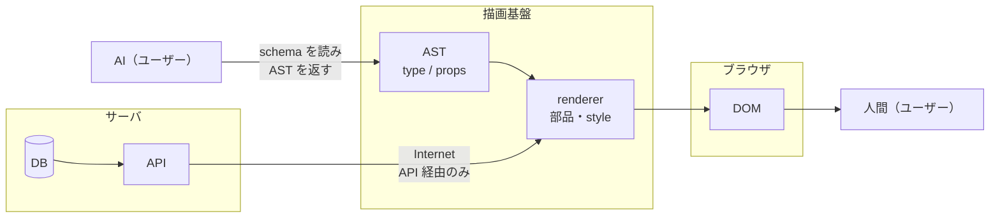

# AI がユーザーになる時代の<br>フロントエンドの<br>システム境界を考える
<p class="cover-sub">~ Generative UI に共通する設計思想 ~</p>
<div>
  <span class="cover-eyebrow">フロントエンドカンファレンス関西 2026 ・ 2026.10.12</span>
  <span class="cover-by">@daitasu</span>
</div>

<style>
:global(.slidev-layout.cover .dino-img) {
  height: 18rem !important;
  width: 18rem;
  bottom: 1.5rem !important;
  right: 1.5rem !important;
  border-radius: 50%;
  object-fit: cover;
}
.cover-sub { margin-top: 0.5rem; font-size: 1.1rem; color: var(--dt-text-muted); }
</style>

---
layout: intro
---

<div class="flex items-center gap-12">
  <div>
    
    <div class="mt-3 flex gap-3 items-end justify-center">
      <div class="flex flex-col items-center">
        <p>X</p>
        
      </div>
      <div class="flex flex-col items-center">
        <p>Tachikawa.any</p>
        
      </div>
    </div>
  </div>
  <div class="text-xl space-y-1.5">
    <h2 class="!text-2xl">自己紹介</h2>
    <div>
      <p>Name:</p>
      <p class="ml-3">@daitasu</p>
    </div>
    <div>
      <p>Favorite:</p>
      <p class="ml-3">TypeScript, Onsen, Dinosaurs</p>
    </div>
    <div>
      <p>Career:</p>
      <p class="ml-3">SIer(2年)→ Frontend (3年) → EM (4年) → IC</p>
    </div>
    <div>
      <p>Community:</p>
      <a class="ml-3" href="https://tachikawaany.connpass.com/" target="_blank">
        Tachikawa.any
      </a>
      <a class="ml-3" href="https://gotanda--ts.connpass.com/event/402821/" target="_blank">
        五反田.ts
      </a>
    </div>
  </div>
</div>

---
layout: two-cols
---

# Generative UI ってなに？

::left::

<div class="mt-4 text-lg">

- LLM が**その場で UI を生成**して返すアプローチ
- 返答が「文章」ではなく、**ボタン・カード・フォーム**そのものになる
- 「今日の天気は？」→ テキストの説明ではなく**天気カード**が返ってくる
- ユーザーは読むだけでなく、返ってきた UI を**そのまま操作**できる

</div>

::right::

<div class="mt-8 flex justify-center">
  
</div>

---

# とはいえ、Generative UI には悩みもある

<div class="mt-8 text-xl">

- 生成される UI は**掛け捨て前提**
  - 会話ごとに生まれて、会話ごとに消える
- 業務アプリケーションにおいては、**変えて良いUI**と**変えてはいけないUI**がある
  - ⭕️ ドメインルールに依存しないstyle、意味を持たない並べ方
  - ❌️ 意味を持つ並び順、ドメインデータの表示
- やりたいこと
  - チャットUIだけでなく、**ユーザーが自由にデザイン構築できる機能(CMS,ノーコードツール)**に**安心安全に**AIの補助輪を入れたい

</div>

---
layout: section
---

# Generative UI の<span class="accent">仕組みの概観</span>を見てみよう

<div class="mt-10 text-lg text-center color-gray">
  Vercel Labs の <strong>json-render</strong>を例に、処理を見ていく
</div>

<div class="mt-3 text-sm text-center color-gray">
  参考: <a href="https://github.com/vercel-labs/json-render" target="_blank">https://github.com/vercel-labs/json-render</a>
</div>

---
layout: two-cols
---

# json-render はどうやっている？

::left::

<div class="mt-6 text-lg space-y-5">
  <div class="howto-step active">① カタログを定義する</div>
  <div class="howto-step">② 実態（コンポーネント）を定義する</div>
  <div class="howto-step">③ カタログからシステムプロンプトを生成</div>
</div>

::right::

```ts
import { defineCatalog } from "@json-render/core";
import { z } from "zod";

export const catalog = defineCatalog({
  components: {
    Stack: {
      props: z.object({
        direction: z.enum(["row", "column"]),
      }),
      hasChildren: true,
    },
    WeatherWidget: {
      props: z.object({
        city: z.string(),
        temperature: z.number(),
        condition: z.string(),
      }),
    },
  },
});
```

<style>
.howto-step { opacity: 0.35; }
.howto-step.active { opacity: 1; font-weight: 700; }
.slidev-code, .slidev-code * { font-size: 11px !important; line-height: 1.5 !important; }
</style>

---
layout: two-cols
---

# json-render はどうやっている？

::left::

<div class="mt-6 text-lg space-y-5">
  <div class="howto-step">① カタログを定義する</div>
  <div class="howto-step active">② 実態（コンポーネント）を定義する</div>
  <div class="howto-step">③ カタログからシステムプロンプトを生成</div>
</div>

::right::

```tsx
import { defineRegistry } from "@json-render/react";
import { catalog } from "./catalog";

export const { registry } = defineRegistry(catalog, {
  components: {
    Stack: ({ props, children }) => (
      <div
        className={
          props.direction === "row"
            ? "flex flex-row gap-2"
            : "flex flex-col gap-2"
        }
      >
        {children}
      </div>
    ),
    WeatherWidget: ({ props }) => (
      <WeatherCard
        city={props.city}
        temperature={props.temperature}
        condition={props.condition}
      />
    ),
  },
});
```

<style>
.howto-step { opacity: 0.35; }
.howto-step.active { opacity: 1; font-weight: 700; }
.slidev-code, .slidev-code * { font-size: 10px !important; line-height: 1.4 !important; }
</style>

---
layout: two-cols
---

# json-render はどうやっている？

::left::

<div class="mt-6 text-lg space-y-5">
  <div class="howto-step">① カタログを定義する</div>
  <div class="howto-step">② 実態（コンポーネント）を定義する</div>
  <div class="howto-step active">③ カタログからシステムプロンプトを生成</div>
</div>

::right::

```ts
const systemPrompt = catalog.prompt();

const result = streamText({
  model: anthropic("claude-haiku-4-5"),
  system: systemPrompt,
  prompt,
});
```

<div class="text-sm color-gray mt-4">

catalog の「使っていい部品と props」が、そのまま LLM への契約になる。

</div>

<style>
.howto-step { opacity: 0.35; }
.howto-step.active { opacity: 1; font-weight: 700; }
.slidev-code, .slidev-code * { font-size: 12px !important; line-height: 1.55 !important; }
</style>

---

# Generative UI は<span class="accent">契約・組み立て・描画</span>に分解できる

<div class="steps">
  <div>
    <p class="step-no">01</p>
    <p class="step-title">契約をつくる</p>
    <p class="step-body">AI が使ってよい部品と規約（catalog）を、人間が書く</p>
  </div>
  <div>
    <p class="step-no">02</p>
    <p class="step-title">AI が組み立てる</p>
    <p class="step-body">AI は HTML ではなく、JSON の構造（spec）を返す</p>
  </div>
  <div>
    <p class="step-no">03</p>
    <p class="step-title">描画関数が描く</p>
    <p class="step-body">描画関数が、JSON をフレームワークの UI に変換する</p>
  </div>
</div>

<p class="mt-14 text-lg">AI が触るのは <strong>JSON だけ</strong>。HTML / CSS / コンポーネントの実体には触れない。</p>

<p class="mt-1 text-xs" style="color: #9ca3af;">※ 正確には、json-render は JSON Patch で spec を 1 行ずつ書き換えていく。ただ概念上は、どの Generative UI 技術も近しい</p>

<style>
.steps { display: grid; grid-template-columns: repeat(3, 1fr); gap: 2.5rem; margin-top: 3rem; }
.steps p { margin: 0; }
.step-no { font-family: 'JetBrains Mono', monospace; font-size: 0.8rem; color: var(--dt-accent); font-weight: 700; }
.step-title { margin-top: 0.4rem !important; font-size: 1.3rem; font-weight: 700; }
.step-body { margin-top: 0.6rem !important; font-size: 0.95rem; line-height: 1.7; color: #4b5563; }
</style>

---

# <span class="accent">抽象構文木（AST）</span>っぽい

<div class="mt-2 text-base">

- json-render (Generative UI)の考え方をもとに拡張し、業務SaaSに組み込むためのASTを考えてみる

</div>

```ts
type NodeBlock = TextNode | ButtonNode | PostsNode;
```

<div class="grid grid-cols-3 gap-3 mt-1">
<div>

```ts
type TextNode = {
  type: "text";
  props: {
    content: string;
    size: "sm" | "md" | "lg";
    weight: "normal" | "bold";
  };
};
```

</div>
<div>

```ts
type ButtonNode = {
  type: "button";
  props: {
    label: string;
    variant: "primary" | "secondary";
    action: "submit" | "cancel";
  };
};
```

</div>
<div>

```ts
type PostsNode = {
  type: "posts";
  props: { limit: 10 | 20 };
  // API 取得・アクションはアプリが注入
  subscribe: { source: "posts" };
  actions: { like: "post.like" };
};
```

</div>
</div>

<div class="ast-notes mt-1 text-xs color-gray">

- AI が書くのは `type` と `props` だけ
  - `type` ... **AI が利用可能なコンポーネント種別**
  - `props` ... **AI に許可された編集範囲**
- `subscribe` は部品が自分で取得し、`actions` はユーザーの操作で発火して、ユーザーの権限で実行される
- 変えてはいけないもの（順序・ドメインデータ）は**部品の内側に閉じ込め**、AI には**置き場所だけ**を選ばせる

</div>

<style>
.slidev-code, .slidev-code * { font-size: 9.5px !important; line-height: 1.5 !important; }
.ast-notes ul { line-height: 1.6; }
.ast-notes ul li { margin-top: 2px; }
.ast-notes ul li::before { line-height: inherit; }
</style>

---

# この木を軸に、システム境界を引く



<div class="grid grid-cols-2 gap-6 mt-2 items-start">
<div class="text-sm mt-2">

- AI は**schema のみ**を見て、作れるUI に一定の制約を作れる
- DB は**API 経由**とし、動的なデータ注入も**権限つき**で隠蔽できる
- 仮に人間が html で書いても、AST 変換で**同じ描画機構**を使える
  - 描画先は React でも Vue でもメールでもいい

</div>
<div>

```txt
apps/
├─ frontend/     packages を呼ぶアプリ層。AI が schema を取得
└─ api/          DB を閉じ込め、権限でデータを解決
packages/
├─ core/
│  └─ schema/    AST の型（Zod）。React もドメインも知らない
└─ renderer/
   ├─ engine/    AST → DOM の描画処理
   └─ registry/  コンポーネントの実体とマッピング
```

</div>
</div>

<style>
.slidev-code, .slidev-code * { font-size: 9.5px !important; line-height: 1.6 !important; }
.grid ul { line-height: 1.7; }
.grid ul li { margin-top: 6px; }
</style>

---

# （余談）先月、<span class="accent">Jev</span> が登場した

<p class="mt-1 text-base color-gray">TypeSafe AI / 2026.09.15 公開 / 初の「System One モデル」</p>

<div class="jev-body">
<dl class="spec">
  <dt>出力</dt><dd>型付きの判断だけ。文章は書かない</dd>
  <dt>生成</dt><dd>トークンを逐次生成せず、一度に返す</dd>
  <dt>速度</dt><dd>0.1 秒台（公称）</dd>
  <dt>確信度</dt><dd>判断ごとに確率が付く</dd>
</dl>

</div>

<p class="mt-8 text-lg">schema から <code>type</code> / <code>props</code> を選ぶのは、<strong>型付きの判断</strong>そのもの。</p>
<p class="mt-1 text-lg">今日話した AST での UI 構築と Jev は相性が良く、<strong>リアルタイムな UI 変化</strong>を提供できる。</p>

<style>
.jev-body { display: grid; grid-template-columns: 1fr 18rem; gap: 2.5rem; align-items: center; }
.jev-body img { width: 100%; }
.spec { display: grid; grid-template-columns: 7rem 1fr; margin-top: 1.6rem; border-top: 1px solid var(--dt-border); }
.spec dt, .spec dd { margin: 0; padding: 0.7rem 0; border-bottom: 1px solid var(--dt-border); font-size: 1.05rem; }
.spec dt { color: var(--dt-text-muted); font-family: 'JetBrains Mono', monospace; font-size: 0.85rem; display: flex; align-items: center; }
</style>

---

# まとめ

<div class="mt-6 text-lg">

- AIにより、**デザイン構築をユーザー側に委ねやすい時代**になっている
  - しかし、**変えて/見えてはいけないもの** はある
- Generative UI の仕組みは、**契約 → AST → 描画** に分解できる
  - AI が提供可能な範囲を制限し、**UIやデータを安全に保つ境界**が必要
  - AI に渡すのは schema だけ。
    - 制約下でUIを作り、データは API が権限つきで解決。人間は AST から写像された DOM を見る
- 判断特化の高速モデルで、**UI をリアルタイムに組み替える**時代も近づいている
- **「AI に何を許すか」 でシステム境界を考えよう**

</div>
